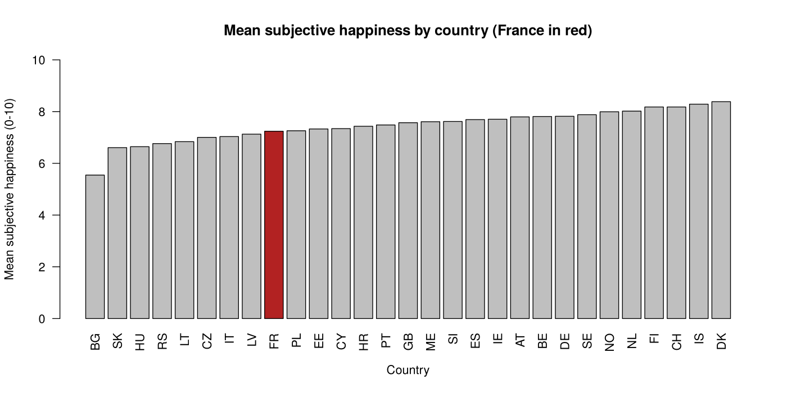
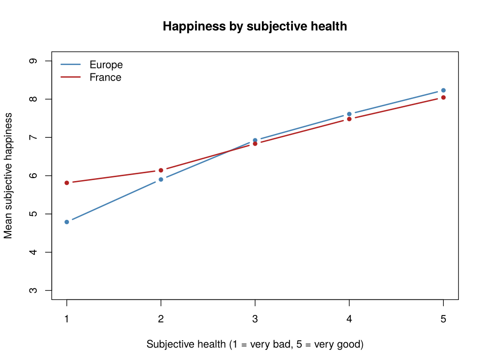
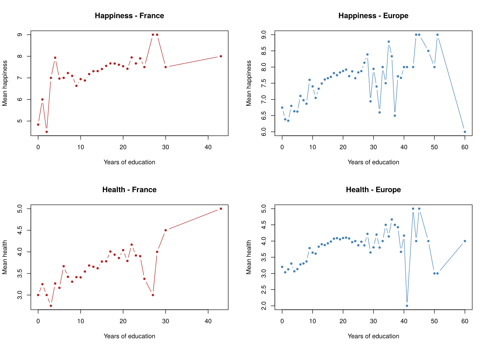
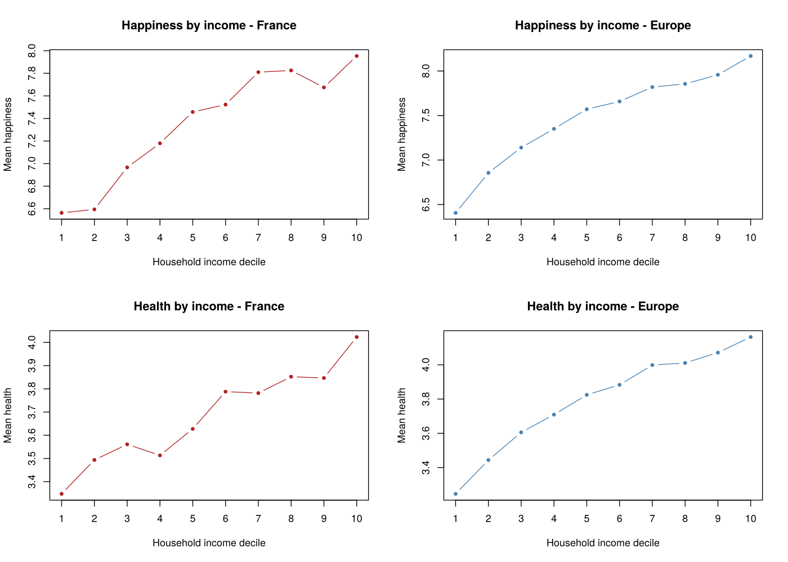

# Health, Happiness & Income in Europe

> 🇫🇷 [Version française](README.fr.md)

**Does the link between health and happiness depend on education and income?** A descriptive analysis of the European Social Survey in R, comparing France with the rest of Europe.

*ENSAE Paris · Descriptive statistics with R (December 2025) · Samuel Placek & Eytan Zaghroun*

## Data

[European Social Survey](https://doi.org/10.21338/ess9e03_2), round 9 (2018), edition 3.2: **49,519 respondents in 29 countries**, including 2,010 in France.

| Variable | ESS code | Scale |
|---|---|---|
| Subjective happiness (target) | `happy` | 0 (extremely unhappy) to 10 (extremely happy) |
| Subjective health | `health` | recoded 1 (very bad) to 5 (very good) |
| Years of education | `eduyrs` | years of full-time education completed |
| Household income | `hinctnta` | decile of total net household income, 1 to 10 |

Non-responses (refusals, "don't know", missing) are removed for each variable.

## Key findings

**1. France sits slightly below the European average.** Mean happiness is 7.2/10 in France vs. 7.4 across all respondents, between Bulgaria (5.6) and Denmark (8.4). France has fewer "very happy" respondents: 9 or 10 out of 10 for 21% of French respondents vs. 29% in Europe.



**2. Health is the strongest correlate of happiness.** Mean happiness rises from 4.8 for people in very bad health to 8.2 for people in very good health (Europe; 5.8 to 8.0 in France).



**3. Education helps, with diminishing returns.** Happiness and health increase with years of education up to about 20 years, then level off. Beyond 30 years, groups are too small for the averages to be reliable.



**4. Income goes hand in hand with happiness, even at the top.** Mean happiness rises steadily from 6.4 in the lowest income decile to 8.2 in the highest (Europe), with no clear saturation point, in line with Stevenson & Wolfers (2008) rather than the Easterlin paradox. Health follows the same gradient (3.3 to 4.2).



All 10 figures (distributions, health by country, education levels…) are in [`figures/`](figures/).

### Limitations
- **Correlation, not causation**: these are descriptive associations, not causal effects.
- All measures except education are **self-reported**.
- Means are **unweighted**, except for the education summary table, which uses the ESS post-stratification weights (`pspwght`).

## Reproducing the analysis

1. Download the data: on the [ESS Data Portal](https://doi.org/10.21338/ess9e03_2), get **ESS round 9, edition 3.2** in CSV format (free registration required). The data cannot be redistributed, so it is not included in this repository.
2. Put `ESS9e03_2.csv` in the `data/` folder.
3. From the root of the repository, run:
   ```bash
   Rscript R/analysis.R
   ```
   The script only uses base R (no package to install). Figures are saved to `figures/` and key statistics are printed to the console.

## Project structure

```
R/analysis.R     Full analysis: cleaning, statistics and figures
figures/         All generated figures (10)
report/          Original report (in French, PDF)
data/            Place ESS9e03_2.csv here (not versioned)
```

## Authors

**Samuel Placek** · **Eytan Zaghroun**: ENSAE Paris
